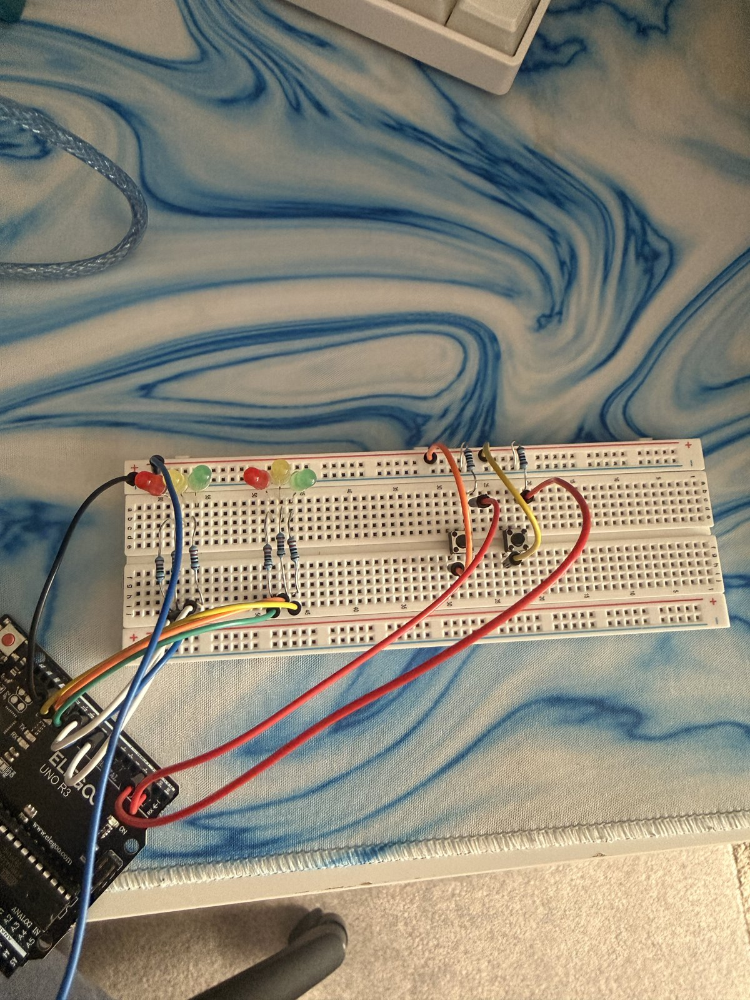

# PLC Traffic Light Intersection (OpenPLC + Arduino Uno)

A two-way traffic light intersection (North-South and East-West) written in **IEC 61131-3 Ladder Logic** with **OpenPLC Editor v4**, tested in the OpenPLC Simulator and then deployed to an **Elegoo Uno R3** driving real LEDs and pushbuttons.

---

## Features

- Six-step traffic cycle with all-red clearance intervals
- **Start** pushbutton: starts the cycle from all-red
- **Stop** pushbutton: immediately forces both directions to red (Stop overrides Start)
- Both reds shown whenever the system is stopped
- Single shared timer design to fit the Arduino Uno's 2 KB of RAM

## Cycle

| Step | North-South | East-West | Time |
|------|-------------|-----------|------|
| 1 | Green  | Red    | 10 s |
| 2 | Yellow | Red    | 3 s  |
| 3 | Red    | Red    | 1 s (all-red) |
| 4 | Red    | Green  | 10 s |
| 5 | Red    | Yellow | 3 s  |
| 6 | Red    | Red    | 1 s, then back to Step 1 |

Full cycle: 28 s.

## Hardware

| Part | Qty |
|------|-----|
| Elegoo Uno R3 (ATmega328P) | 1 |
| LEDs: red, yellow, green | 2 each |
| 220 Ω resistors (LED current limiting) | 6 |
| Pushbuttons | 2 |
| 10 kΩ resistors (button pull-downs) | 2 |
| Breadboard and jumper wires | – |

### I/O map

| Tag | Uno pin | IEC address | Type |
|-----|---------|-------------|------|
| Start_PB | D2 | %IX0.0 | Input |
| Stop_PB | D3 | %IX0.1 | Input |
| NS_Red | D8 | %QX0.0 | Output |
| NS_Yellow | D9 | %QX0.1 | Output |
| NS_Green | D10 | %QX0.2 | Output |
| EW_Red | D11 | %QX0.3 | Output |
| EW_Yellow | D12 | %QX0.4 | Output |
| EW_Green | D13 | %QX0.5 | Output |

### Wiring

- **LEDs:** Uno pin → 220 Ω → LED anode (long leg); LED cathode (short leg) → GND rail.
- **Buttons:** 5V → button → Uno pin, with a 10 kΩ pull-down from the pin to GND (pressed = TRUE).

## How the program works

The ladder program is split into clear sections:

1. **Run latch (seal-in):** `(Start_PB OR Run) AND NOT Stop_PB → Run`
2. **Stop reset:** while `Run` is off, every step bit is reset.
3. **Auto-start:** when `Run` is on and no step is active, set `Step6` (all-red) so the cycle starts safely.
4. **Step time select:** three `MOVE` blocks (with EN/ENO) load `Step_Time` with 10 s, 3 s or 1 s depending on the active step.
5. **Shared timer:** `Run AND NOT T_Done → TON T_Step (PT = Step_Time) → T_Done`. When the timer finishes, `T_Done` pulses for one scan and the timer automatically restarts for the next step.
6. **Transition bits:** `StepN AND T_Done → DoneN`. All six are evaluated *before* any step changes, so one timer pulse can only advance one step.
7. **Step sequencing:** `DoneN → SET Step(N+1)` and `DoneN → RESET StepN` (Step 6 wraps back to Step 1).
8. **Outputs:** kept separate from the sequence logic, e.g. `NS_Red = Step3 OR Step4 OR Step5 OR Step6 OR NOT Run`.

### Design note: fitting in 2 KB of RAM

The first version used one TON timer per step (six timers). On the Uno this compiled to **118% of dynamic memory** and would not build. Removing unused auto-generated timer instances got it to 93%, but with only 129 bytes left the board froze at runtime.

Replacing the six timers with **one shared timer** whose preset is selected by the active step brought RAM use down to **76% (474 bytes free)**, and the program runs reliably.

## Running it

1. Install **OpenPLC Editor v4** (desktop).
2. Open this project folder.
3. **Simulator:** Device → OpenPLC Simulator → press Play.
4. **Arduino Uno:**
   1. Device → select **Arduino Uno**.
   2. Pin Mapping: add digital inputs 2, 3 and digital outputs 8–13 (in that order).
   3. Select the board's COM port.
   4. Connect → **Build & Upload**.
5. Tap **Start** (D2) to run the cycle and **Stop** (D3) to force all red.

## Testing

| Test | Action | Expected result |
|------|--------|-----------------|
| Idle | Power on | Both reds on |
| Start | Tap Start | 1 s all-red, then the 28 s cycle repeats |
| Stop | Tap Stop mid-cycle | Both reds on immediately; stays stopped |
| Restart | Tap Start again | Cycle restarts from all-red |

## Possible extensions

- Pedestrian WALK request (latched, served on the next North-South green)
- Night mode (flashing reds)
- Conflict monitor that latches a fault if both directions are ever green/yellow

## Tools

https://github.com/user-attachments/assets/d9b297d9-58ed-4394-9b4b-8852d67edff2

- OpenPLC Editor v4 (Ladder Diagram, IEC 61131-3)
- OpenPLC Simulator
- Elegoo Uno R3
